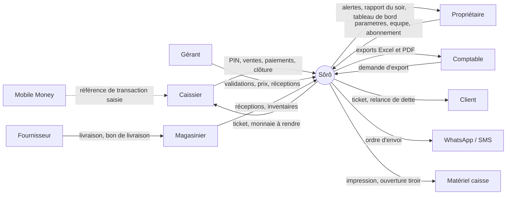
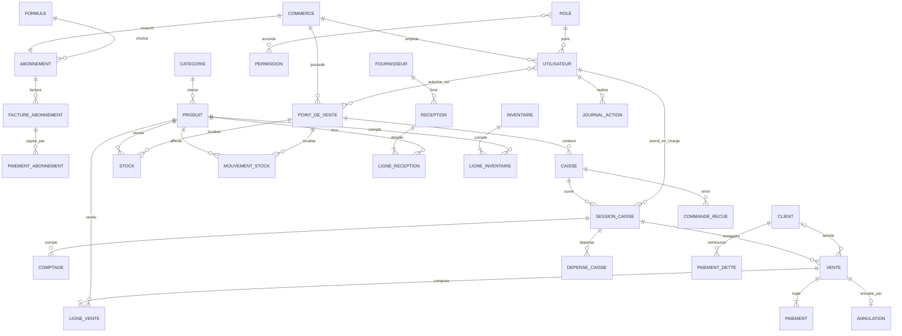
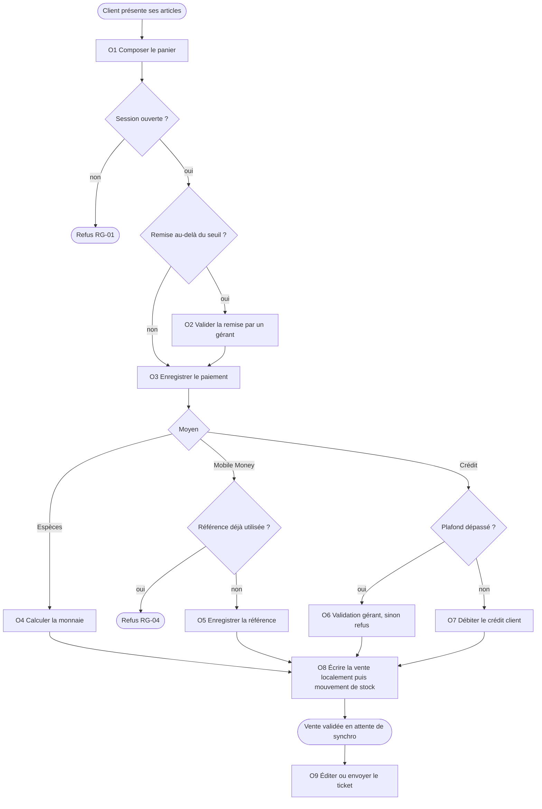

# Analyse Merise de Sôrô

Source : cahier des charges, `constitution.md`, `docs/architecture.md`, spécification MVP. Les choix qui ne figurent pas dans ces documents sont marqués **[Proposition]** ; les inconnues métier sont listées en section 11 et restent ouvertes.

Sommaire : 1 Périmètre · 2 Acteurs et flux · 3 Règles de gestion · 4 Dictionnaire de données · 5 MCD · 6 MCT · 7 MOT · 8 MLD · 9 MPD · 10 Matrice CRUD · 11 Points ouverts.

---

## 1. Périmètre et domaines

Sôrô est un SaaS multi-commerce de caisse, fonctionnant hors ligne, vendu par abonnement.

| Domaine | Contenu | Priorité |
|---|---|---|
| D1 Tenancy et identité | Commerce, points de vente, caisses, utilisateurs, rôles, paramètres | MVP |
| D2 Point de vente | Sessions de caisse, ventes, paiements, annulations, dépenses, tickets | MVP |
| D3 Catalogue et stock | Produits, catégories, stock, mouvements, réceptions, inventaires | MVP (base) / V1 |
| D4 Clients et crédit | Clients, dettes, remboursements de dette | V1 |
| D5 Reporting et audit | Tableaux de bord, rapports, journal des actions sensibles | MVP (minimal) / V1 |
| D6 Abonnement | Formules, échéances, factures, paiements d'abonnement | V1 |
| D7 Synchronisation et messages | Commandes reçues (idempotence), envois WhatsApp/SMS | MVP / V1 |

Hors périmètre : comptabilité complète, paie, vente en ligne, équipements métier (pompes, balances connectées).

---

## 2. Modèle conceptuel de communication (MCC)

### 2.1 Acteurs

| Acteur | Rôle |
|---|---|
| Caissier | Ouvre sa session, vend, encaisse, clôture |
| Gérant | Valide remises, annulations et dépassements de crédit ; gère produits, prix, réceptions |
| Propriétaire | Paramètre, suit à distance, gère l'équipe et l'abonnement |
| Magasinier | Réceptions, transferts, inventaires |
| Comptable (lecture) | Consulte et exporte |
| Client final | Achète, reçoit ticket et relances |
| Fournisseur | Livre la marchandise |
| Opérateur Mobile Money | Orange, MTN, Moov, Wave (déclaratif en MVP) |
| Passerelle WhatsApp / SMS | Envoi des tickets, rapports et relances |
| Matériel (imprimante, tiroir-caisse, douchette) | Impression, ouverture du tiroir, saisie du code-barres |

### 2.2 Diagramme de flux



Le flux Mobile Money est en pointillé : en MVP la référence est **saisie** par le caissier, sans confirmation automatique (V2 : agrégateur).

---

## 3. Règles de gestion

### 3.1 Règles du cahier des charges

| N° | Règle | Paramétrable |
|---|---|---|
| RG-01 | Vente uniquement sur caisse ouverte par un utilisateur connecté | Non |
| RG-02 | Vente validée jamais supprimée ; annulation par opération inverse, motif et validation gérant | Non |
| RG-03 | Remise au-delà d'un seuil : validation gérant | Seuil |
| RG-04 | Mobile Money : référence obligatoire et unique | Non |
| RG-05 | Vente en stock nul : bloquée ou autorisée avec alerte | Oui |
| RG-06 | Crédit refusé au-delà du plafond sauf validation gérant | Plafond |
| RG-07 | Écart de clôture enregistré, signalé au-delà d'un seuil | Seuil |
| RG-08 | Caisse non clôturée en fin de journée signalée | Heure |
| RG-09 | Changement de prix : ventes suivantes seulement | Non |
| RG-10 | Ajustement de stock : motif obligatoire, tracé | Non |
| RG-11 | Prix d'achat moyen recalculé à chaque réception | Non |
| RG-12 | Hors ligne : derniers prix reçus ; synchronisation dans l'ordre | Non |
| RG-13 | Tickets et factures numérotés sans trou, par point de vente | Non |
| RG-14 | Abonnement impayé : lecture seule après délai de grâce, données conservées | Délai |

### 3.2 Règles complémentaires dérivées des documents

| N° | Règle | Origine |
|---|---|---|
| RG-15 | Toute ligne métier porte `TenantId` ; accès autorisé côté serveur | Constitution 4 |
| RG-16 | Ventes, paiements et mouvements de stock sont append-only ; correction par écriture compensatoire | Constitution 5 |
| RG-17 | Les identifiants créés sur appareil sont des UUID ; un renvoi ne crée pas de doublon | Constitution 6 |
| RG-18 | Montants en FCFA entiers, sans décimales | Constitution 7 |
| RG-19 | Une vente reçoit tenant, point de vente, caisse, session et utilisateur | REQ-07 |
| RG-20 | Le total d'une vente = somme des lignes − remises ; somme des paiements = total (crédit inclus) | Calcul métier |
| RG-21 | Le prix unitaire d'une ligne est figé à la vente | RG-09 |
| RG-22 | Un rôle ne peut accomplir que les actions autorisées ; un refus est tracé | SC-04 |
| RG-23 | Une seule session de caisse ouverte à la fois par caisse **[Proposition]** | Cohérence |
| RG-24 | Montant attendu à la clôture = fond + espèces encaissées − monnaie rendue − dépenses | Calcul métier |

---

## 4. Dictionnaire de données

Types : `UUID`, `TXT` (texte), `INT` (entier), `MNT` (montant FCFA entier), `QTE` (quantité décimale à 3 chiffres, pour la vente au poids en V2), `DAT` (date et heure UTC), `BOOL`, `ENUM`. Toutes les entités portent `tenant_id` (non répété ci-dessous).

### 4.1 Tenancy et identité
| Entité | Propriétés |
|---|---|
| COMMERCE | id_commerce UUID, nom, type_activite ENUM, logo, options_activees, id_formule, telephone_proprietaire, date_creation |
| POINT_DE_VENTE | id_pdv UUID, nom, adresse, prefixe_ticket |
| CAISSE | id_caisse UUID, nom, identifiant_appareil, derniere_synchro DAT, statut_appareil ENUM(actif, révoqué) |
| UTILISATEUR | id_utilisateur UUID, nom, telephone, identifiant, pin_hash, mot_de_passe_hash, statut |
| ROLE | code ENUM(proprietaire, gerant, caissier, magasinier, comptable), libelle |
| PERMISSION | code_permission, libelle (ex. `remise.valider`, `vente.annuler`) |
| PARAMETRE | cle, valeur (seuil_remise, plafond_credit_defaut, seuil_ecart, heure_alerte_cloture, delai_grace, stock_negatif_autorise, taxes) |

### 4.2 Point de vente
| Entité | Propriétés |
|---|---|
| SESSION_CAISSE | id_session UUID, date_ouverture, fond_caisse MNT, date_cloture, montant_attendu MNT, montant_compte MNT, ecart MNT, statut ENUM(ouverte, clôturée) |
| COMPTAGE | id_comptage, denomination MNT, quantite INT (détail billets et pièces) |
| VENTE | id_vente UUID, numero_ticket INT, date_vente, total_brut MNT, total_remise MNT, total_net MNT, statut ENUM(validée, annulée), seq_locale INT |
| LIGNE_VENTE | no_ligne INT, quantite QTE, prix_unitaire MNT (figé), remise MNT, libelle_produit (copie) |
| PAIEMENT | id_paiement UUID, moyen ENUM(espèces, orange, mtn, moov, wave, crédit), montant MNT, reference_transaction TXT, monnaie_rendue MNT |
| ANNULATION | id_annulation UUID, date, motif, id_gerant_validateur |
| DEPENSE_CAISSE | id_depense UUID, montant MNT, motif, photo_justificatif, date |
| VENTE_EN_ATTENTE | id_attente UUID, contenu_panier, date_mise_en_attente (stockée localement uniquement) |
| ENVOI_MESSAGE | id_envoi UUID, canal ENUM(whatsapp, sms), destinataire, type ENUM(ticket, rapport, relance, code), statut, date_envoi |

### 4.3 Catalogue et stock
| Entité | Propriétés |
|---|---|
| CATEGORIE | id_categorie UUID, nom |
| PRODUIT | id_produit UUID, nom, code_barres, photo, unite, prix_vente MNT, prix_achat_moyen MNT, seuil_alerte QTE, actif BOOL, est_prestation BOOL |
| STOCK | quantite QTE (par produit et par point de vente) |
| MOUVEMENT_STOCK | id_mouvement UUID, type ENUM(vente, réception, perte, transfert, inventaire, annulation), quantite QTE (signée), motif, date, source_type, id_source |
| FOURNISSEUR | id_fournisseur UUID, nom, contact, solde_du MNT |
| RECEPTION | id_reception UUID, date, reference_livraison |
| LIGNE_RECEPTION | quantite QTE, prix_achat MNT |
| INVENTAIRE | id_inventaire UUID, date, statut |
| LIGNE_INVENTAIRE | quantite_theorique QTE, quantite_comptee QTE, ecart QTE |

### 4.4 Clients, audit, abonnement, synchronisation
| Entité | Propriétés |
|---|---|
| CLIENT | id_client UUID, nom, telephone, plafond_credit MNT, solde_dette MNT, points_fidelite INT (V2), consentement_messages BOOL |
| PAIEMENT_DETTE | id_paiement_dette UUID, montant MNT, moyen, reference, date |
| JOURNAL_ACTION | id_journal UUID, action, date, valeur_avant, valeur_apres, motif, id_ressource |
| FORMULE | code ENUM(démarrage, commerce, réseau), nb_caisses_max, nb_utilisateurs_max, prix_mensuel MNT |
| ABONNEMENT | id_abonnement UUID, date_debut, echeance, statut ENUM(essai, actif, grâce, lecture seule) |
| FACTURE_ABONNEMENT | id_facture UUID, periode, montant MNT, statut |
| PAIEMENT_ABONNEMENT | id_paiement UUID, moyen ENUM(mobile money, virement), reference, montant MNT, date |
| COMMANDE_RECUE | id_commande UUID (clé d'idempotence), type, id_caisse, seq_locale, statut ENUM(acceptée, rejetée, conflit), code_erreur, date_reception |

---

## 5. Modèle conceptuel des données (MCD)

### 5.1 Associations et cardinalités (notation Merise)

Lecture : `ENTITÉ A (min,max) —ASSOCIATION— (min,max) ENTITÉ B`. La première cardinalité est du côté de A.

| Association | Entité A | Entité B | Attributs portés |
|---|---|---|---|
| POSSÉDER | COMMERCE (0,n) | POINT_DE_VENTE (1,1) | — |
| CONTENIR | POINT_DE_VENTE (0,n) | CAISSE (1,1) | — |
| EMPLOYER | COMMERCE (1,n) | UTILISATEUR (1,1) | — |
| TENIR_LE_RÔLE | UTILISATEUR (1,1) | ROLE (0,n) | — |
| ACCORDER | ROLE (0,n) | PERMISSION (0,n) | — |
| AUTORISER_SUR | UTILISATEUR (1,n) | POINT_DE_VENTE (0,n) | — |
| OUVRIR | CAISSE (0,n) | SESSION_CAISSE (1,1) | — |
| PRENDRE_EN_CHARGE | UTILISATEUR (0,n) | SESSION_CAISSE (1,1) | — |
| COMPTER | SESSION_CAISSE (0,n) | COMPTAGE (1,1) | — |
| ENREGISTRER | SESSION_CAISSE (0,n) | VENTE (1,1) | — |
| COMPOSER | VENTE (1,n) | PRODUIT (0,n) | no_ligne, quantité, prix figé, remise |
| RÉGLER | VENTE (1,n) | PAIEMENT (1,1) | — |
| ACHETER | CLIENT (0,n) | VENTE (0,1) | — |
| ANNULER | VENTE (0,1) | ANNULATION (1,1) | — |
| VALIDER | UTILISATEUR (0,n) | ANNULATION (1,1) | — |
| DÉPENSER | SESSION_CAISSE (0,n) | DEPENSE_CAISSE (1,1) | — |
| CLASSER | CATEGORIE (0,n) | PRODUIT (1,1) | — |
| STOCKER | PRODUIT (0,n) | POINT_DE_VENTE (0,n) | quantité |
| AFFECTER | PRODUIT (0,n) | MOUVEMENT_STOCK (1,1) | — |
| LOCALISER | POINT_DE_VENTE (0,n) | MOUVEMENT_STOCK (1,1) | — |
| LIVRER | FOURNISSEUR (0,n) | RECEPTION (1,1) | — |
| DÉTAILLER_RÉCEPTION | RECEPTION (1,n) | PRODUIT (0,n) | quantité, prix d'achat |
| RECEVOIR_EN | POINT_DE_VENTE (0,n) | RECEPTION (1,1) | — |
| COMPTER_STOCK | INVENTAIRE (1,n) | PRODUIT (0,n) | théorique, compté, écart |
| REMBOURSER | CLIENT (0,n) | PAIEMENT_DETTE (1,1) | — |
| TRACER | UTILISATEUR (0,n) | JOURNAL_ACTION (1,1) | — |
| SOUSCRIRE | COMMERCE (1,1) | ABONNEMENT (1,1) | — |
| CHOISIR | FORMULE (0,n) | ABONNEMENT (1,1) | — |
| FACTURER | ABONNEMENT (0,n) | FACTURE_ABONNEMENT (1,1) | — |
| PAYER_FACTURE | FACTURE_ABONNEMENT (0,n) | PAIEMENT_ABONNEMENT (1,1) | — |
| ÉMETTRE | CAISSE (0,n) | COMMANDE_RECUE (1,1) | — |

Notes de modélisation :
- `COMPOSER`, `STOCKER`, `DÉTAILLER_RÉCEPTION` et `COMPTER_STOCK` sont des associations porteuses ; elles deviennent des tables à clé composée au MLD.
- Les tables à identifiant UUID créé à la caisse (vente, paiement, dépense, annulation, mouvement) restent des entités à identifiant propre : c'est ce qui rend la synchronisation idempotente.
- `MOUVEMENT_STOCK` référence sa source (vente, réception, inventaire) par `source_type` et `id_source` plutôt que par des clés étrangères multiples **[Proposition]**.
- `ENVOI_MESSAGE` et `VENTE_EN_ATTENTE` ne portent pas d'association au MCD : l'envoi référence sa cible par `type` et destinataire ; la vente en attente vit seulement dans IndexedDB.

### 5.2 Schéma (équivalent Mermaid)



---

## 6. Modèle conceptuel des traitements (MCT)

Chaque traitement suit : **Événement → Opération (avec synchronisation et conditions) → Résultat**.

### 6.1 T1 Ouverture de caisse
| Élément | Contenu |
|---|---|
| Événement | Le caissier se présente en début de service |
| Opération 1 : Authentifier | Vérifie le PIN ; refuse si utilisateur inactif ou appareil révoqué |
| Condition | PIN valide ? non → refus tracé |
| Opération 2 : Ouvrir la session | RG-23 : aucune session ouverte sur la caisse ; enregistre le fond de caisse |
| Résultat | SESSION_CAISSE ouverte ; vente possible (RG-01) |

### 6.2 T2 Vente et encaissement (cœur du MVP)

| Résultat | VENTE, LIGNE_VENTE, PAIEMENT, MOUVEMENT_STOCK(vente) créés ; ticket émis ; commande placée dans la file d'envoi |

### 6.3 T3 Synchronisation
| Élément | Contenu |
|---|---|
| Événement | Retour du réseau, ou nouvelle vente avec réseau disponible |
| Opération 1 : Envoyer la file | Envoie dans l'ordre de la caisse (seq_locale) |
| Opération 2 : Contrôler la commande | Si `id_commande` déjà traité → renvoie l'accusé sans recréer (RG-17) |
| Condition | Référence Mobile Money en double ? stock négatif ? prix changé ? → rejet ou conflit visible |
| Opération 3 : Persister | Transaction atomique vente, paiements, stock, audit |
| Résultat | COMMANDE_RECUE statuée ; accusé stocké sur la caisse ; erreurs actionnables, jamais supprimées en silence |

### 6.4 T4 Annulation ou remise sensible
| Élément | Contenu |
|---|---|
| Événement | Demande d'annulation d'une vente validée |
| Condition | L'utilisateur est-il gérant ? sinon refus tracé (SC-04) |
| Opération | Crée ANNULATION avec motif ; écritures inverses (paiement, stock) ; vente passe à « annulée » (RG-02, RG-16) |
| Résultat | Opération inverse tracée dans JOURNAL_ACTION |

### 6.5 T5 Dépense de caisse
Événement : sortie d'espèces. Opération : saisir montant, motif, photo. Résultat : DEPENSE_CAISSE rattachée à la session, prise en compte dans le montant attendu (RG-24).

### 6.6 T6 Clôture de caisse
| Élément | Contenu |
|---|---|
| Événement | Fin de service |
| Opération 1 | Compte les billets et pièces (COMPTAGE) |
| Opération 2 | Calcule le montant attendu (RG-24) et l'écart |
| Condition | Écart au-delà du seuil ? oui → signalé au propriétaire (RG-07) |
| Résultat | Session clôturée ; écart conservé et visible après synchronisation |

### 6.7 T7 Réception fournisseur
Événement : livraison. Opérations : saisir les lignes ; créer RECEPTION ; créer MOUVEMENT_STOCK(réception) ; recalculer le prix d'achat moyen (RG-11) ; ajuster le solde dû au fournisseur (V2). Résultat : stock et prix moyen à jour.

### 6.8 T8 Inventaire et ajustement
Événement : comptage physique. Opérations : comparer théorique et compté ; exiger un motif (RG-10) ; créer les mouvements d'ajustement. Résultat : stock corrigé par écritures, journalisé.

### 6.9 T9 Vente à crédit et remboursement de dette
Vente à crédit : voir T2 (condition de plafond, RG-06). Remboursement : l'événement « le client paie sa dette » crée PAIEMENT_DETTE et diminue `solde_dette`.

### 6.10 T10 Reporting et alertes
| Élément | Contenu |
|---|---|
| Événements | Fin de journée (planifié) ; vente synchronisée (temps réel) ; stock sous seuil |
| Opérations | Agréger le chiffre d'affaires, panier moyen, paiements, caissiers ; détecter les caisses non clôturées (RG-08) |
| Résultat | Tableau de bord mis à jour ; rapport du soir envoyé ; alertes de rupture et d'écart |

### 6.11 T11 Abonnement
Événement : échéance. Condition : paiement reçu ? Sinon délai de grâce puis lecture seule (RG-14). Résultat : statut d'abonnement mis à jour, facture créée, données conservées.

### 6.12 T12 Inscription d'un commerce
Événement : demande d'inscription. Opérations : créer COMMERCE, abonnement d'essai, propriétaire, premier point de vente ; importer ou saisir les produits ; inviter les caissiers. Résultat : commerce prêt à vendre.

---

## 7. Modèle organisationnel des traitements (MOT)

| Traitement | Poste | Lieu | Mode | Acteur | Disponible hors ligne |
|---|---|---|---|---|---|
| T1 Ouverture | Caisse | PWA locale | Interactif | Caissier | Oui |
| T2 Vente | Caisse | PWA + IndexedDB | Interactif | Caissier (gérant pour validation) | Oui |
| T3 Synchronisation | Caisse puis API | PWA vers cloud | Différé automatique | Système | Reprise au retour du réseau |
| T4 Annulation | Caisse ou back-office | Local puis cloud | Interactif | Gérant | Partiellement **[à décider]** |
| T5 Dépense | Caisse | PWA locale | Interactif | Caissier | Oui |
| T6 Clôture | Caisse | PWA locale | Interactif | Caissier | Oui |
| T7 Réception | Back-office | Cloud | Interactif | Magasinier, gérant | Non prévu au MVP |
| T8 Inventaire | Back-office | Cloud | Interactif | Magasinier | Non prévu au MVP |
| T9 Dette | Caisse ou back-office | Mixte | Interactif | Caissier, gérant | Selon la politique de crédit hors ligne |
| T10 Reporting | Serveur | Cloud (Hangfire, SignalR) | Planifié et temps réel | Système | Sans objet |
| T11 Abonnement | Serveur | Cloud | Planifié | Système, propriétaire | Sans objet |
| T12 Inscription | Web | Cloud | Interactif | Propriétaire | Non |

Principe : les traitements de caisse (T1, T2, T5, T6) s'exécutent localement ; les règles critiques sont revalidées côté serveur à la synchronisation (`docs/architecture.md`, règles de dépendance).

---

## 8. Modèle logique des données (MLD relationnel)

Convention : `PK` clé primaire, `FK` clé étrangère. `tenant_id` (FK vers `commerce`) est présent partout, sauf `commerce`, et est inclus dans les contraintes d'unicité quand c'est utile.

```
commerce(PK id_commerce, nom, type_activite, logo, options_activees, FK code_formule, telephone_proprietaire, date_creation)
formule(PK code, nb_caisses_max, nb_utilisateurs_max, prix_mensuel)
abonnement(PK id_abonnement, FK tenant_id, FK code_formule, date_debut, echeance, statut)
facture_abonnement(PK id_facture, FK tenant_id, FK id_abonnement, periode, montant, statut)
paiement_abonnement(PK id_paiement, FK tenant_id, FK id_facture, moyen, reference, montant, date)

point_de_vente(PK id_pdv, FK tenant_id, nom, adresse, prefixe_ticket)
caisse(PK id_caisse, FK tenant_id, FK id_pdv, nom, identifiant_appareil, derniere_synchro, statut_appareil)
role(PK code, libelle)
permission(PK code_permission, libelle)
role_permission(PK FK code_role, PK FK code_permission)
utilisateur(PK id_utilisateur, FK tenant_id, FK code_role, nom, telephone, identifiant, pin_hash, mot_de_passe_hash, statut)
utilisateur_pdv(PK FK id_utilisateur, PK FK id_pdv)
parametre(PK FK tenant_id, PK cle, valeur)

session_caisse(PK id_session, FK tenant_id, FK id_caisse, FK id_utilisateur, date_ouverture, fond_caisse, date_cloture, montant_attendu, montant_compte, ecart, statut)
comptage(PK id_comptage, FK tenant_id, FK id_session, denomination, quantite)
vente(PK id_vente, FK tenant_id, FK id_pdv, FK id_caisse, FK id_session, FK id_utilisateur, FK id_client NULL, numero_ticket, date_vente, total_brut, total_remise, total_net, statut, seq_locale)
ligne_vente(PK FK id_vente, PK no_ligne, FK tenant_id, FK id_produit, libelle_produit, quantite, prix_unitaire, remise)
paiement(PK id_paiement, FK tenant_id, FK id_vente, moyen, montant, reference_transaction NULL, monnaie_rendue)
annulation(PK id_annulation, FK tenant_id, FK id_vente UNIQUE, FK id_gerant, motif, date)
depense_caisse(PK id_depense, FK tenant_id, FK id_session, montant, motif, photo_justificatif, date)

categorie(PK id_categorie, FK tenant_id, nom)
produit(PK id_produit, FK tenant_id, FK id_categorie, nom, code_barres, photo, unite, prix_vente, prix_achat_moyen, seuil_alerte, est_prestation, actif)
stock(PK FK id_produit, PK FK id_pdv, FK tenant_id, quantite)
mouvement_stock(PK id_mouvement, FK tenant_id, FK id_produit, FK id_pdv, FK id_utilisateur, type, quantite, motif, date, source_type, id_source)
fournisseur(PK id_fournisseur, FK tenant_id, nom, contact, solde_du)
reception(PK id_reception, FK tenant_id, FK id_fournisseur, FK id_pdv, FK id_utilisateur, date, reference_livraison)
ligne_reception(PK FK id_reception, PK FK id_produit, FK tenant_id, quantite, prix_achat)
inventaire(PK id_inventaire, FK tenant_id, FK id_pdv, FK id_utilisateur, date, statut)
ligne_inventaire(PK FK id_inventaire, PK FK id_produit, FK tenant_id, quantite_theorique, quantite_comptee, ecart)

client(PK id_client, FK tenant_id, nom, telephone, plafond_credit, solde_dette, consentement_messages)
paiement_dette(PK id_paiement_dette, FK tenant_id, FK id_client, FK id_utilisateur, montant, moyen, reference, date)

journal_action(PK id_journal, FK tenant_id, FK id_utilisateur, action, date, valeur_avant, valeur_apres, motif, id_ressource)
envoi_message(PK id_envoi, FK tenant_id, canal, destinataire, type, statut, date_envoi)
commande_recue(PK id_commande, FK tenant_id, FK id_caisse, type, seq_locale, statut, code_erreur, date_reception)
```

### Règles de passage MCD → MLD
- Association (n,1) : clé étrangère dans l'entité côté 1 (`caisse.id_pdv`, `vente.id_session`).
- Association (n,n) : nouvelle table (`role_permission`, `utilisateur_pdv`, `stock`).
- Association porteuse : table à clé composée, attributs portés en colonnes (`ligne_vente`, `ligne_reception`, `ligne_inventaire`).
- `ligne_vente.libelle_produit` copie le nom du produit pour que le ticket reste fidèle après modification du catalogue (RG-09, RG-21).

---

## 9. Modèle physique (PostgreSQL 18)

Extraits représentatifs ; le script complet sera généré en migrations EF Core.

```sql
CREATE TYPE moyen_paiement AS ENUM ('especes','orange','mtn','moov','wave','credit');
CREATE TYPE statut_vente   AS ENUM ('validee','annulee');
CREATE TYPE statut_session AS ENUM ('ouverte','cloturee');

CREATE TABLE vente (
  id_vente       uuid PRIMARY KEY,
  tenant_id      uuid NOT NULL REFERENCES commerce(id_commerce),
  id_pdv         uuid NOT NULL REFERENCES point_de_vente(id_pdv),
  id_caisse      uuid NOT NULL REFERENCES caisse(id_caisse),
  id_session     uuid NOT NULL REFERENCES session_caisse(id_session),
  id_utilisateur uuid NOT NULL REFERENCES utilisateur(id_utilisateur),
  id_client      uuid REFERENCES client(id_client),
  numero_ticket  bigint,
  date_vente     timestamptz NOT NULL,
  total_brut     bigint NOT NULL CHECK (total_brut >= 0),
  total_remise   bigint NOT NULL DEFAULT 0 CHECK (total_remise >= 0),
  total_net      bigint NOT NULL CHECK (total_net = total_brut - total_remise),
  statut         statut_vente NOT NULL DEFAULT 'validee',
  seq_locale     bigint NOT NULL,
  UNIQUE (tenant_id, id_pdv, numero_ticket),    -- RG-13 (voir OP-1)
  UNIQUE (tenant_id, id_caisse, seq_locale)     -- ordre par caisse
);

CREATE TABLE paiement (
  id_paiement    uuid PRIMARY KEY,
  tenant_id      uuid NOT NULL REFERENCES commerce(id_commerce),
  id_vente       uuid NOT NULL REFERENCES vente(id_vente),
  moyen          moyen_paiement NOT NULL,
  montant        bigint NOT NULL CHECK (montant > 0),
  reference_transaction text,
  monnaie_rendue bigint NOT NULL DEFAULT 0,
  CHECK ((moyen IN ('orange','mtn','moov','wave')) = (reference_transaction IS NOT NULL)) -- RG-04
);
-- RG-04 : unicité de la référence (périmètre exact à valider, voir OP-2)
CREATE UNIQUE INDEX ux_paiement_reference
  ON paiement (tenant_id, moyen, reference_transaction)
  WHERE reference_transaction IS NOT NULL;

CREATE TABLE mouvement_stock (
  id_mouvement uuid PRIMARY KEY,
  tenant_id    uuid NOT NULL REFERENCES commerce(id_commerce),
  id_produit   uuid NOT NULL REFERENCES produit(id_produit),
  id_pdv       uuid NOT NULL REFERENCES point_de_vente(id_pdv),
  type         text NOT NULL,
  quantite     numeric(14,3) NOT NULL,          -- signée
  motif        text,
  date         timestamptz NOT NULL,
  CHECK (type NOT IN ('perte','inventaire') OR motif IS NOT NULL) -- RG-10
);

CREATE TABLE commande_recue (
  id_commande    uuid PRIMARY KEY,              -- idempotence (RG-17)
  tenant_id      uuid NOT NULL REFERENCES commerce(id_commerce),
  id_caisse      uuid NOT NULL REFERENCES caisse(id_caisse),
  statut         text NOT NULL,
  code_erreur    text,
  date_reception timestamptz NOT NULL DEFAULT now()
);
```

### Append-only (RG-02, RG-16)
```sql
CREATE FUNCTION interdire_suppression() RETURNS trigger AS $$
BEGIN RAISE EXCEPTION 'Suppression interdite sur %', TG_TABLE_NAME; END $$ LANGUAGE plpgsql;

CREATE TRIGGER vente_no_delete BEFORE DELETE ON vente
  FOR EACH ROW EXECUTE FUNCTION interdire_suppression();
CREATE TRIGGER mvt_no_delete BEFORE DELETE ON mouvement_stock
  FOR EACH ROW EXECUTE FUNCTION interdire_suppression();
```

### Isolation par commerce (RG-15)
```sql
ALTER TABLE vente ENABLE ROW LEVEL SECURITY;
ALTER TABLE vente FORCE ROW LEVEL SECURITY;
CREATE POLICY vente_tenant ON vente
  USING (tenant_id = current_setting('app.tenant_id')::uuid)
  WITH CHECK (tenant_id = current_setting('app.tenant_id')::uuid);
-- Même politique sur chaque table portant tenant_id.
-- Le contexte app.tenant_id est posé par transaction depuis l'identité authentifiée.
```

### Index principaux
| Index | Usage |
|---|---|
| `produit (tenant_id, code_barres)` | Scan en moins d'une seconde |
| `produit` GIN trigramme sur `nom` | Recherche par nom sur plusieurs milliers de références |
| `vente (tenant_id, id_pdv, date_vente)` | Tableau de bord et rapports par période |
| `vente (tenant_id, id_session)` | Clôture |
| `mouvement_stock (tenant_id, id_produit, id_pdv, date)` | Historique de stock |
| `commande_recue (tenant_id, id_caisse, statut)` | Suivi des rejets |

### Stockage local (IndexedDB)
| Magasin | Contenu |
|---|---|
| `catalogue` | Produits, prix, codes-barres, stock local |
| `sessions` | Session de caisse courante |
| `journal` | Ventes et opérations confirmées, avec statut local/en attente/synchronisé |
| `attentes` | Ventes mises en attente (non synchronisées) |
| `outbox` | Commandes à envoyer, ordonnées par `seq_locale` |
| `rejets` | Commandes en erreur ou conflit, à traiter |

---

## 10. Matrice CRUD (traitements × entités)

C = création, R = lecture, U = modification, — = aucun accès.

| Entité | T1 | T2 | T3 | T4 | T5 | T6 | T7 | T8 | T9 | T10 | T11 |
|---|---|---|---|---|---|---|---|---|---|---|---|
| UTILISATEUR | R | R | — | R | R | R | R | R | R | R | — |
| SESSION_CAISSE | C | R | U | — | R | U | — | — | — | R | — |
| PRODUIT | — | R | R | — | — | — | R/U | R | — | R | — |
| STOCK | — | U | U | U | — | — | U | U | — | R | — |
| MOUVEMENT_STOCK | — | C | C | C | — | — | C | C | — | R | — |
| VENTE | — | C | C | U (statut) | — | R | — | — | — | R | — |
| LIGNE_VENTE | — | C | C | R | — | — | — | — | — | R | — |
| PAIEMENT | — | C | C | C (inverse) | — | R | — | — | — | R | — |
| ANNULATION | — | — | C | C | — | — | — | — | — | R | — |
| DEPENSE_CAISSE | — | — | C | — | C | R | — | — | — | R | — |
| COMPTAGE | — | — | C | — | — | C | — | — | — | R | — |
| CLIENT | — | R/U | U | U | — | — | — | — | R/U | R | — |
| PAIEMENT_DETTE | — | — | C | — | — | — | — | — | C | R | — |
| RECEPTION, LIGNE_RECEPTION | — | — | — | — | — | — | C | — | — | R | — |
| INVENTAIRE, LIGNE_INVENTAIRE | — | — | — | — | — | — | — | C | — | R | — |
| COMMANDE_RECUE | — | — | C/U | — | — | — | — | — | — | R | — |
| JOURNAL_ACTION | C | C | C | C | C | C | C | C | C | R | C |
| ABONNEMENT, FACTURE, PAIEMENT_ABO | — | — | — | — | — | — | — | — | — | R | C/U |
| ENVOI_MESSAGE | — | C | — | — | — | — | — | — | — | C | C |

T1 Ouverture · T2 Vente · T3 Synchronisation · T4 Annulation · T5 Dépense · T6 Clôture · T7 Réception · T8 Inventaire · T9 Dette · T10 Reporting · T11 Abonnement.

---

## 11. Points ouverts

Ces points viennent des documents du projet ; la colonne « Proposition » est une piste à valider, pas une décision.

| Réf. | Sujet | Impact sur le modèle | Proposition |
|---|---|---|---|
| OP-1 | Numérotation sans trou hors ligne (RG-13) | `vente.numero_ticket`, table de plages | Attribuer à chaque caisse une plage de numéros réservée au cloud ; justifier tout trou dans une plage non utilisée |
| OP-2 | Périmètre de l'unicité des références Mobile Money | Index unique `paiement` | Unicité par commerce et opérateur ; confirmer avec le pilote |
| OP-3 | Valeur d'un paiement Mobile Money saisi hors ligne | Statut sur `paiement` | Ajouter `statut_verification` (déclaré, confirmé) |
| OP-4 | Stock négatif après synchronisation multi-caisses | Statut `conflit` de `commande_recue`, RG-05 | Accepter la vente, signaler le conflit au gérant |
| OP-5 | Prix modifié pendant la période hors ligne | `ligne_vente.prix_unitaire` | Conserver le prix de la caisse (RG-12) et signaler l'écart |
| OP-6 | PIN hors ligne, révocation d'appareil, durée d'accès | `caisse.statut_appareil`, jetons | À cadrer en sécurité avant le pilote |
| OP-7 | Taxes et mentions de ticket | Colonnes de TVA sur `ligne_vente` | Attendre la réponse du pilote ; TVA activable (cahier des charges) |
| OP-8 | Impression : navigateur ou agent local | Aucun impact sur le modèle | Décider sur le matériel du pilote |
| OP-9 | Politique de conservation et RPO/RTO | Archivage | À préciser |
| OP-10 | Annulation et dette hors ligne | MOT T4, T9 | Décider si ces actions sont possibles sans réseau |
